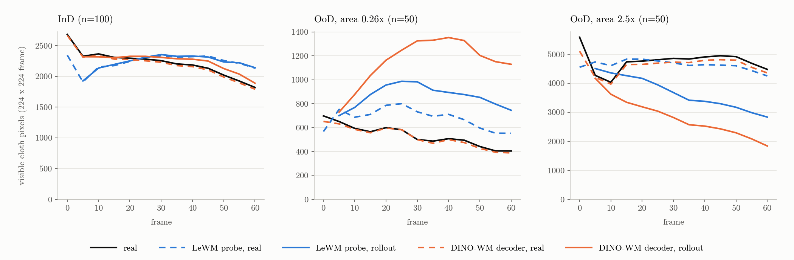

# LeWM on ACWM-Phys

LeWM 을 [ACWM-Phys](https://huggingface.co/datasets/t1an/ACWM-Phys) environment 4개 (Cloth Move, Push Sand, Stack Cube, Pour Water) 의 InD 학습 데이터로 학습하고, OoD test 에서 물체 양을 어떻게 예측하는지 DINO-WM 과 비교했다. DINO-WM 결과는 [jongmin-s-multicore/thread0#6](https://github.com/jongmin-s-multicore/thread0/issues/6) 의 것이다. DINO-WM 은 DINOv2 encoder 를 고정하고 predictor 만 학습한다. LeWM 은 encoder (ViT-tiny) 와 predictor 를 pixel 에서 scratch 부터 함께 학습한다.

## Results

Rollout 의 물체 양 (pixel 수) 이다. Rollout 은 첫 real frame 과 모든 action 으로 예측한다. Cloth Move, Push Sand 는 마지막 frame (60), Pour Water 는 frame 250–295 의 평균이다. 괄호는 real 대비 비율이다.

| Environment | Test | n | Real | LeWM probe, real frames | LeWM probe, rollout | DINO-WM Enc→Dec | DINO-WM rollout |
|---|---|---:|---:|---:|---:|---:|---:|
| Cloth Move (cloth pixels) | InD | 100 | 1,819 | 2,134 (117%) | 2,140 (118%) | 1,790 (98%) | 1,888 (104%) |
| | OoD, area 0.26x | 50 | 404 | 552 (137%) | 744 (184%) | 388 (96%) | 1,129 (279%) |
| | OoD, area 2.5x | 50 | 4,475 | 4,248 (95%) | 2,832 (63%) | 4,352 (97%) | 1,836 (41%) |
| Push Sand (sand pixels) | InD | 100 | 1,792 | 1,776 (99%) | 1,772 (99%) | 1,729 (96%) | 1,665 (93%) |
| | OoD, 2x sand | 100 | 3,886 | 3,845 (99%) | 2,526 (65%) | 3,215 (83%) | 1,843 (47%) |
| Pour Water (water pixels in the box) | InD | 50 | 1,970 | 1,994 (101%) | 2,081 (106%) | 1,962 (100%) | 2,045 (104%) |
| | OoD, less water | 26 | 1,384 | 1,386 (100%) | 1,922 (139%) | 1,370 (99%) | 2,049 (148%) |
| | OoD, more water | 24 | 2,407 | 2,354 (98%) | 1,984 (82%) | 2,326 (97%) | 2,077 (86%) |

- LeWM 은 decoder 가 없어서 embedding 에서 물체 양을 읽는 ridge probe 로 쟀다. "real frames" 는 real frame 의 embedding 에 probe 를 쓴 값이고, "rollout" 은 예측한 embedding 에 쓴 값이다.
- DINO-WM 은 decoder 출력에서 #6 과 같은 color mask 로 쟀다. "Enc→Dec" 는 real frame 을 encoder 와 decoder 로 복원한 값이다. 같은 probe 를 DINO-WM latent 에 쓰면 decoder 값과 같게 나온다 (Cloth Move OoD 2.5x rollout, probe 1,867, decoder 1,836).
- LeWM rollout 도 OoD 물체 양을 학습 때 값 쪽으로 옮긴다. Cloth Move 와 Push Sand 에서는 DINO-WM 보다 덜 옮기고 (63% 대 41%, 65% 대 47%), Pour Water 에서는 비슷하다 (82% 대 86%, 139% 대 148%).
- Cloth Move real frame probe 의 R² 는 LeWM 0.880, DINO-WM 0.992 다. LeWM 은 학습할수록 R² 가 줄었다 (epoch 10 0.988, 50 0.918, 100 0.880).
- Stack Cube 는 #6 과 비교하지 못했다. 학습 중간 (epoch 44 와 88 사이) 부터 encoder embedding 이 episode 안에서 거의 변하지 않았다 (차원당 분산 0.003). 최종 model 의 예측 오차는 copy-last 와 같고, "쌓였는가" 는 probe 로 읽히지 않았다. Validation loss 는 끝까지 줄었다.



Cloth Move test group 별 평균이다. 검정은 real frame, 파랑은 LeWM probe (점선 real frame embedding, 실선 rollout), 주황은 DINO-WM decoder (점선 Enc→Dec, 실선 rollout) 다.

## Setup

| Item | Value |
|---|---|
| Data | ACWM-Phys (HF `t1an/ACWM-Phys`, commit `4017e5f`), #6 과 같은 split. mp4 를 stable-worldmodel HDF5 (224×224) 로 변환했다 (`acwm/convert_acwm.py`) |
| Action | Cloth Move 6차원 (항상 1.0 인 3, 7번 차원 제거), Push Sand 다음 frame 의 pusher pose (x, z, cos yaw, sin yaw), Stack Cube 7차원, Pour Water 2차원 (항상 0 인 0, 2번 차원 제거) |
| Model | le-wm 기본값 (`8edfeb3`). ViT-tiny/14 encoder (pretraining 없음), 6-layer predictor, 18.0M parameters, history 3, frameskip 5, batch size 128, AdamW lr 5e-5, SIGReg weight 0.09 |
| Training | Environment 마다 약 64k optimizer step (#6 의 DINO-WM 과 같은 수). Cloth Move 100 epochs, Push Sand 115, Stack Cube 175, Pour Water 33. Seed 1개 |
| Hardware | Colab RTX PRO 6000 Blackwell (G4), 학습 2개를 한 GPU 에서 함께 실행. 학습 하나 8.2–8.4 step/s, 최대 GPU memory 12.5 GiB |
| Probe | Ridge regression, embedding → 물체 양. Group 마다 test episode 를 짝수, 홀수로 나눠 한쪽의 real frame embedding 으로 맞추고 다른 쪽에 적용한 뒤 서로 바꾼다 |

ACWM-Phys 는 simulator 를 공개하지 않아서 planning 은 평가하지 않았다.

## Reproduce

LeWM 사용법은 [upstream README](https://github.com/lucas-maes/le-wm#readme) 에 있다. 아래 명령은 이 checkout 에서 실행한다.

```bash
uv venv --python=3.10 && source .venv/bin/activate
uv pip install "stable-worldmodel[train,env]" "transformers<5" "datasets>=3" hdf5plugin
export STABLEWM_HOME=/path/to/storage ACWM_DATA_ROOT=/path/to/ACWM-Phys
hf download t1an/ACWM-Phys --repo-type dataset --revision 4017e5f5900a7a8590d4e944b6a84f55df75a0c1 --local-dir $ACWM_DATA_ROOT
```

```bash
# decord, torchvision, h5py 가 있는 Python. env: cloth_move, push_sand, stack_cube, pour_water
python -I acwm/convert_acwm.py $ACWM_DATA_ROOT $STABLEWM_HOME/acwm --env cloth_move
```

```bash
python acwm/train_timed.py data=acwm_cloth_move output_model_name=lewm_cloth_move subdir=lewm_cloth_move \
  num_workers=8 trainer.max_epochs=100 loader.persistent_workers=False loader.prefetch_factor=2
```

```bash
python acwm/eval_acwm.py cloth_move $STABLEWM_HOME/checkpoints/lewm_cloth_move $STABLEWM_HOME/acwm results/eval_cloth_move
```

`acwm/train_timed.py` 는 `train.py` 에 step 속도와 GPU memory log 를 더한 script 다. Epoch 수는 Setup 표의 값을 쓴다. DINO-WM latent 에 같은 probe 를 쓰는 비교는 `acwm/dinowm_latents.py` 와 `acwm/probe_dinowm.py` 로 한다. DINO-WM model 은 HF [`hanbin5/dino-wm-acwm-phys`](https://huggingface.co/hanbin5/dino-wm-acwm-phys) 의 `outputs/train_cloth_h1f5` 다.
