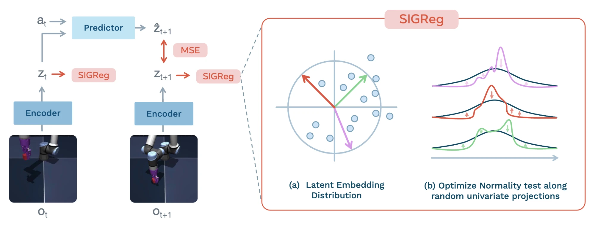
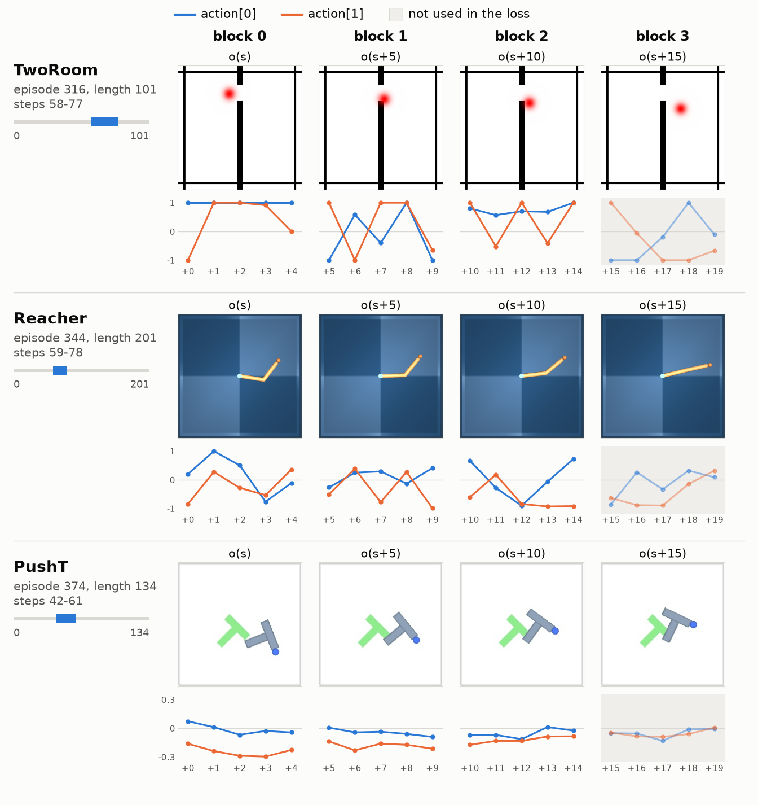
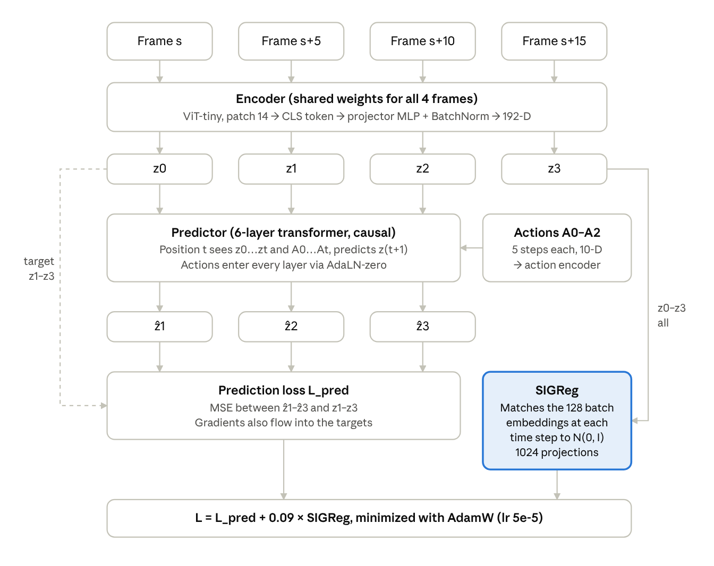

# LeWM: Datasets and Training



LeWorldModel training pipeline ([paper](https://arxiv.org/abs/2603.19312), Figure 1).

LeWM learns a world model from offline trajectories of RGB frames and actions, with no rewards or task labels. The encoder and the predictor are trained together from scratch with two loss terms. One model is trained per environment, for 10 epochs with batch size 128.

```math
\begin{aligned} \mathcal{L} &= \underbrace{\lVert \hat{z}_{t+1} - z_{t+1} \rVert_2^2}_{\text{prediction}} + \lambda \, \underbrace{\mathrm{SIGReg}(Z)}_{\text{anti-collapse}}, \qquad \lambda = 0.09 \\ \hat{z}_{t+1} &= \mathrm{pred}(z_t, a_t), \qquad z_t = \mathrm{enc}(o_t) \end{aligned}
```

The prediction term trains the predictor and makes the embeddings predictable. SIGReg keeps the embeddings spread out like $\mathcal{N}(0, I)$, so the encoder cannot map every frame to the same vector. $\lambda$ is the only loss weight to tune. On PushT the success rate stays above 80% for $\lambda$ between 0.01 and 0.2. There is no stop-gradient, EMA or pretrained encoder.

## Dataset requirements

LeWM can be trained on any offline dataset that meets these conditions.

- Each step has one RGB frame (`pixels`) and one continuous action (`action`) of fixed size. The action at step $t$ is the one taken after frame $t$. Only these two go into the model.
- Episodes are at least 20 steps long and recorded at a constant control rate.
- No rewards or task labels. Expert, scripted and random policies all work if the data covers the dynamics.
- Very simple, low-diversity data is a weak case for SIGReg. The paper gives this as the likely reason LeWM does worst on TwoRoom.
- The file is a stable-worldmodel HDF5 file: one array per column, plus `ep_len` and `ep_offset`.
- Planning evaluation also needs the simulator state of every step, to reset the start and the goal.



Each row is one training sample from the released .h5 files. Frames are 5 steps apart, and the graph under each frame shows the raw actions of the next 5 steps. The actions in block 3 are not used in the loss. The bar on the left shows where the 20-step window sits in its episode.

## Training step

Each training sample is a 20-step window: 4 frames 5 steps apart, each followed by a block of 5 actions. The predictor sees up to 3 frames of history and predicts the next embedding at each position.



- The targets $z_1$–$z_3$ come from the same encoder and also receive gradients. Action block $A_3$ is loaded but not used.
- SIGReg projects the 128 embeddings of each time step onto 1024 random directions and compares each projection with $\mathcal{N}(0, 1)$ using the Epps–Pulley statistic.
- Frames are resized to 224×224 and normalized with ImageNet statistics. Actions are z-scored per dimension.

## Training setup

All four environments use the same settings. Only the action dimension changes.

| Item | Value |
| --- | --- |
| Model | ViT-tiny encoder (5.50M), 6-layer transformer predictor (10.79M), 18.03M in total |
| Optimizer | AdamW, lr 5e-5, weight decay 1e-3 |
| LR schedule | Linear warmup over the first 1% of steps, then cosine decay. Updated every step |
| Batch, precision | 128, bf16, gradient clipping 1.0 |
| Epochs | 10 in the paper, 100 in the config |
| Steps per epoch | TwoRoom 5,138, Reacher 12,796, PushT 13,933 |
| SIGReg | $\lambda$ 0.09 (0.1 in the paper text), 1024 projections |

- Epochs: the authors set a 100-epoch schedule and stopped at 10 ([#52](https://github.com/lucas-maes/le-wm/issues/52)). The learning rate is still about 98% of its peak at that point. Setting `max_epochs` to 10 gives a different schedule.
- Precision: users report NaN losses and spikes with bf16, fixed by switching to fp32 ([#36](https://github.com/lucas-maes/le-wm/issues/36)).
- History: the paper uses 1 frame of history for TwoRoom, while the released TwoRoom checkpoint config uses 3 ([#100](https://github.com/lucas-maes/le-wm/issues/100), no answer yet).

## Released datasets

The authors release one dataset per environment in the Hugging Face collection [`quentinll/lewm`](https://huggingface.co/collections/quentinll/lewm-69c58f5e20580628114d20c4) (MIT).

| Environment | Task | Collection policy | Episodes | Length (frames) | Action | Extra keys loaded | Size (zst / h5) |
| --- | --- | --- | --- | --- | --- | --- | --- |
| TwoRoom | 2D navigation. The agent passes a door to reach a goal in the other room | Noisy heuristic: door first, then goal | 10,000 | 31–101, mean 92 | 2-D, [-1, 1] | proprio (agent position, 2-D) | 3.4 GB / 12.8 GB |
| Reacher (DMC) | Match a 2-joint arm to a target pose | SAC in the paper. The released actions are uniform random in [-1, 1] | 10,000 | 201 | 2-D, [-1, 1] | observation (6-D) | 23.8 GB / 98.9 GB |
| PushT | 2D manipulation. Push a T block to a target pose | Expert demonstrations, DINO-WM PushT train split | 18,685 | 49–246, mean 125 | 2-D, -1.5 to 2.0 | proprio (4-D), state (7-D) | 13.1 GB / 46.3 GB |
| OGBench-Cube | 3D manipulation. A robot arm picks up a cube and places it at a target | OGBench data-collection heuristic | 10,000 | 200 | 5-D | observation, proprio | 46.2 GB / – |

PushT is the DINO-WM PushT train split. The paper reports 20,000 episodes with mean length 196, while the file has 18,685 with mean length 125. Reacher actions in the file are uniform random, while the paper describes SAC data ([#98](https://github.com/lucas-maes/le-wm/issues/98)). The Cube episode count and length are the paper's values (Appendix E).

## References

- Paper: [LeWorldModel, arXiv 2603.19312 v3](https://arxiv.org/abs/2603.19312) (revised 2026-06-03). Section 3.1, Appendix A, D, E, G.
- Code: [lucas-maes/le-wm](https://github.com/lucas-maes/le-wm) commit 8edfeb3. `train.py`, `jepa.py`, `module.py`, `config/train/`. Installation, training and evaluation commands are in the [upstream README](https://github.com/lucas-maes/le-wm#readme).
- Dataloader: [galilai-group/stable-worldmodel](https://github.com/galilai-group/stable-worldmodel) commit 21446f1. `data/dataset.py`, `data/formats/hdf5.py`.
- Training loop: [galilai-group/stable-pretraining](https://github.com/galilai-group/stable-pretraining) commit ab836bf. `module.py`, `optim/lr_scheduler.py`.
- Data and checkpoints: [Hugging Face collection quentinll/lewm](https://huggingface.co/collections/quentinll/lewm-69c58f5e20580628114d20c4).
- Upstream issues: [#36](https://github.com/lucas-maes/le-wm/issues/36) bf16 loss spikes, [#52](https://github.com/lucas-maes/le-wm/issues/52) `max_epochs`, [#98](https://github.com/lucas-maes/le-wm/issues/98) Reacher data policy, [#100](https://github.com/lucas-maes/le-wm/issues/100) TwoRoom history.
